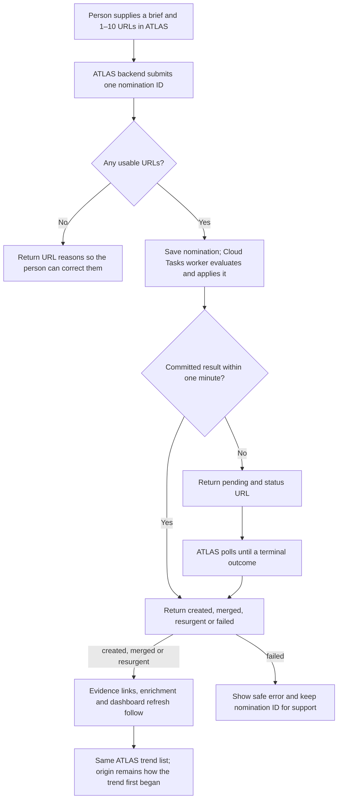

<!-- Title: Trend Tree Editorial Nomination Workflow -->
<!-- Parent: ATLAS Dashboard -->

**Audience:** Jason Smith and the ATLAS product team.

**Status:** The outcome/readback and preview backend described below is **live as of 2026-11-17**. ATLAS owns its form, result display and dev credential setup. **Last updated:** 2026-11-17.

**Purpose:** Show how a person's nomination moves from the ATLAS form into Trend Tree, what ATLAS can tell them, and where the resulting trend sits next to discovered trends. Developers should use the [API contract](editorial-nomination-api.md).

## What an editorial trend means

An **editorial trend** is a trend a strategist or editor nominates by hand from ATLAS. Here the term describes a human origin; it does not mean the entity editors create in the Trend Hunter CMS. A **discovered trend** is one the pipeline finds from signals on its own.

Both are normal trends in the same dashboard table, `DT_TREND_DASHBOARD`. The `TREND_ORIGIN` column records how each trend first came to exist: `EDITORIAL` or `DISCOVERED`.

## From the form to an outcome

The person writes a short brief and attaches one to ten URLs. ATLAS generates one nomination ID and sends the request from its backend. Trend Tree drops dead or malformed URLs; blocked, slow and paywalled pages can still be kept. If no URL survives, ATLAS shows the reasons so the person can correct the submission.

For an accepted nomination, a worker writes a topic from the brief and page titles, then checks whether it matches an existing trend, including retired trends. It applies the result and records what committed. The judgment has no subject-matter rejection: it creates a trend or merges into a match. Infrastructure or processing errors can still prevent completion, and those errors have their own visible outcome.

ATLAS can wait up to one minute for that outcome. A completed result comes back with HTTP `200`; work still in progress comes back with HTTP `202`, `pending` and a status URL. ATLAS polls that URL, normally every five seconds, until it has a terminal outcome. A slow response is not a failure and must not be presented as one.

The one-minute window limits the initial response, not the full evaluation. In the production check on 2026-11-17 with the queue running normally, the initial response was pending at about 60 seconds and the committed merge was observed at about 97 seconds. That single run illustrates why ATLAS needs polling; it is not a completion-time guarantee.

## What ATLAS can tell the person

| Outcome | What happened | What to show |
| --- | --- | --- |
| `pending` | Evaluation, application or a retry is still running | “Your nomination is being processed.” Keep checking its status. |
| `created` | A new trend was committed | “Your nomination created a trend.” Keep its returned trend ID; the full card follows later. |
| `merged` | The nomination merged into an existing trend | “Your nomination added evidence to an existing trend.” Show that trend when available. |
| `resurgent` | The nomination merged and revived a retired trend | “Your nomination brought a retired trend back.” Show that trend when available. |
| `failed` | Processing ended without completing the operation | Show the safe service message and retain the nomination ID for support. |

These are nomination outcomes, separate from a trend's changing lifecycle. A `resurgent` nomination keeps that outcome even if the trend later becomes `GROWING` or `STABLE`. A failed nomination may already have a known trend target after partial processing; ATLAS must preserve that information and must not say that nothing changed.

If the connection drops, ATLAS checks the same ID and retries the same submission as needed. The first accepted content wins, so a network retry does not become a second nomination or replace its URLs. A deliberate new nomination gets a new ID.

## Where the trend lands

| Evaluation result | Resulting trend | Origin |
| --- | --- | --- |
| No existing trend matches | New trend, initially `NEW`; naming and full enrichment follow | `EDITORIAL` |
| An existing active trend matches | Existing trend gains the supplied evidence; no second trend | Unchanged |
| A retired trend matches and revival commits | Existing trend returns as `RESURGENT`; no second trend | Unchanged |

**A nomination that matches a discovered trend leaves that trend `DISCOVERED`.** Origin describes how the trend first began, not every later contribution to it. The nomination's receipt records the merge and target; changing the target's origin is unnecessary.

The supplied URLs become evidence through the signal pipeline. Existing signals retain their original source and metadata when another person supplies the same URL. A separate nomination association records each supplied URL against its nomination without duplicating the signal. It records acceptance, not proof that all downstream work has finished.

The committed outcome is available before naming, full enrichment, evidence-link tasks and the dashboard refresh finish. `DT_TREND_DASHBOARD` targets a 15-minute refresh lag. A successful nomination can therefore have a trend ID before its complete ATLAS card is available; that delay is separate from the one-minute response window.

After creation, an editorial trend receives the same scores, lifecycle rules and normal evidence attribution as a discovered trend. `HEAT_INDEX`, `PREDICTION_SCORE` and the opportunity score do not read the origin. Being nominated does not give a trend a score boost or special treatment in later evidence attribution.

## A tag or a separate tab

`TREND_ORIGIN` already supports either display without a backend change:

- **A tag:** show an editorial badge on trends where `TREND_ORIGIN = 'EDITORIAL'`, within the shared list.
- **A separate tab:** filter the editorial tab to `EDITORIAL`, with discovered trends in the other tab.

ATLAS owns that choice. A nomination merged into a discovered trend gets no editorial-origin badge and does not enter an editorial-origin tab. If the intent is to show **every nomination a person made**, including merges, ATLAS should retain its nomination IDs and outcomes and link each to the returned trend ID. Origin alone cannot provide that view. This backend extension adds readback by ID, not a ready-made nomination-history screen or list endpoint.

## Trying the form in ATLAS dev

The extension includes a preview route and a separate preview-only key. Dev can validate the request and URLs and run the same topic/match evaluation. It returns provisional `would_create`, `would_merge` or `would_revive`, with an existing trend ID only when a match exists.

Preview creates no production nomination, signal, candidate, promotion or revival, queues no work and starts no enrichment. Its key cannot submit production nominations or read their private history. Preview is evaluated again on every call, has no stored result to poll, and can differ from a later production evaluation. It still makes provider calls and incurs their normal charges.

## Release and handoff

The response contract and preview decisions are settled in [CRMA-1719](https://mcclatchy.atlassian.net/browse/CRMA-1719) and the [outcome specification](../prd/editorial-nomination-outcomes.md). The [production release record](../runbooks/editorial-nomination-outcomes-2026-11-17.md) covers the deployed Cloud Run revision, Snowflake changes and live checks. The preview credential exists in Trend Tree Secret Manager; an authorized ATLAS operator still needs to install it in ATLAS dev.

The Confluence publication link and Jason's review are tracked in [CRMA-1721](https://mcclatchy.atlassian.net/browse/CRMA-1721). Publication makes this guide available to the ATLAS team; Jason's reply and the remaining ATLAS integration work are separate handoff steps.
